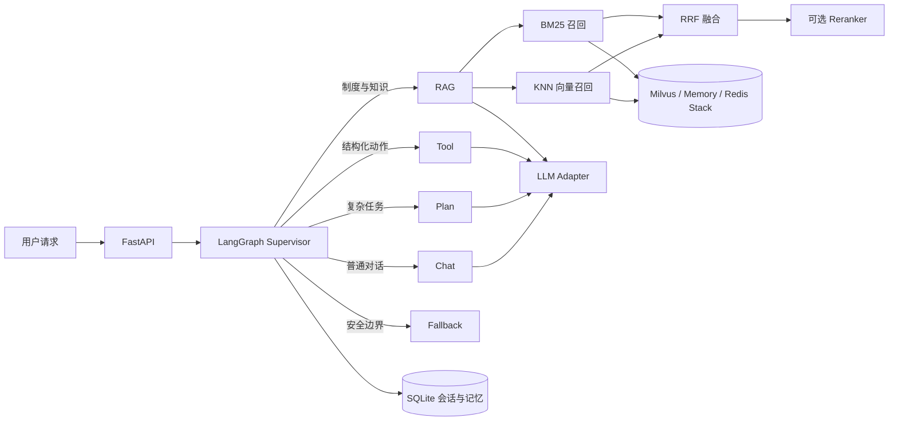

# Agentic RAG Platform｜企业制度与办事智能助手

GitHub：<https://github.com/shmoon250216-sys/agentic-rag-platform>

面向企业制度、报销规范和办事材料分散的场景，系统把文档入库、混合检索、来源引用、工具调用、任务规划、会话记忆和异常兜底组织为一条可运行的 Agent 工作流。用户可以上传 PDF/DOCX 制度文档，通过统一聊天入口查询规则、调用工具或生成办事计划，并在管理接口中追踪会话、记忆和工作流快照。

## 解决的问题

- **入口分散**：将知识问答、结构化工具和复杂任务规划统一到一个聊天接口，由 Supervisor 决定执行分支。
- **文档难检索**：解析 PDF/DOCX 后切分文档，分别执行 BM25 关键词召回和向量召回，通过 RRF 融合排名，并可选用 Reranker 精排；回答同时返回来源片段。
- **连续追问缺少前文**：将最近对话、较早用户摘录和相关长期记忆注入模型；对常见省略追问补充前文主题后检索。语言与详略偏好按字段更新，记录设有过期和容量限制。
- **外部依赖影响本地开发**：默认使用确定性的本地模型和 Hash Embedding，LLM、Embedding 与检索后端均通过适配层切换。全栈部署默认使用 Milvus 持久化，离线开发显式使用内存。
- **修改容易破坏链路**：固定评测覆盖 RAG、工具、规划、聊天和安全兜底，并以自动化测试验证文档、缓存、记忆和接口行为。

## 真实检索评测与证据核验

新增 [完整流程与学习说明](docs/retrieval-evidence-upgrade.md)、[56 题合成评测集](examples/retrieval_benchmark_v1.json) 和 [实际运行报告](docs/live-retrieval-results.json)。评测使用真实 Milvus 与配置的 Qwen Embedding，共享线上检索实现，分别比较 BM25、向量与 RRF；不是 Hash 模拟的语义成绩。

回答以 `[S1]` 标注片段，返回文档 ID、片段 ID 和内容 SHA256；Milvus 后端支持点击核验当前片段，内容变化返回 409、删除返回 404。会话历史保留引用快照。该校验确认来源存在和内容一致，不证明答案被证据支持，也不提供未经解析的 PDF 页码。

## 核心流程



## 已实现能力

- FastAPI 服务、Token 校验、统一聊天接口和 SSE 流式响应。
- LangGraph `StateGraph`，包含 `rag`、`tool`、`plan`、`chat`、`fallback` 五类分支。
- PDF/DOCX 上传校验、文本解析、重叠切分、BM25/向量双路召回、加权 RRF 融合和来源返回。
- 可配置 HTTP Reranker；服务超时或响应异常时按配置回退到 RRF 排名。
- 本地 Hash Embedding 与 OpenAI-compatible Embedding 适配器。
- Milvus 持久化后端：Jieba/BM25 稀疏倒排索引、HNSW/COSINE 向量索引、模型版本检查、文档删除和加权 RRF；保留内存与 Redis Stack 兼容适配。
- SQLite 分层上下文：最近消息窗口、有界用户摘录摘要、跨会话长期记忆；偏好更新、过期/容量清理、会话归属校验和最终运行快照。详见 [`docs/memory.md`](docs/memory.md)。
- MCP 风格工具注册表、参数 Schema 校验和标准化工具结果。
- TTL 检索缓存与回答缓存，文档变更时主动失效。
- 存活/就绪检查、Docker Compose、质量门禁与自动化测试。

## 快速启动

要求 Python 3.11+。下面是无数据库服务的离线开发模式（`RAG_BACKEND=memory`）。**Milvus 完整部署见 [docs/milvus.md](docs/milvus.md)**；全栈 `docker compose up` 默认使用 Milvus，需 Docker Compose 2.20+，Windows 需先配置 Linux 容器环境。

```powershell
python -m venv .venv
.\.venv\Scripts\Activate.ps1
pip install -e ".[dev]"
Copy-Item .env.example .env
uvicorn app.main:create_app --factory --reload --port 8010
```

启动后访问：

- 操作界面：<http://127.0.0.1:8010/docs>
- API 文档：<http://127.0.0.1:8010/api/docs>
- 存活检查：<http://127.0.0.1:8010/health>
- 依赖检查：<http://127.0.0.1:8010/health/ready>

```powershell
curl -X POST "http://127.0.0.1:8010/api/v1/chat" `
  -H "Content-Type: application/json" `
  -H "Authorization: Bearer dev-token" `
  -d '{"message":"差旅住宿标准是什么？","user_id":"demo-user"}'
```

## 真实文档验证

`examples/evaluation_questions.json` 保留早期 PDF 上传练习的查询方向。旧专项脚本依赖早期 PDF；本地缺少文件时需补齐输入。新评测直接使用 `examples/retrieval_benchmark_v1.json` 中的 8 份合成制度，不依赖该 PDF；不含真实企业或个人数据。

```powershell
python scripts/run_evaluation.py
pytest -q
```

当前本地全量回归 **157 项通过、1 项跳过**（Redis 集成未配置）；包含真实 Milvus 生命周期与上传期间检索的并发验证。CI 在干净环境中另行执行，不将本地结果冒充远端 CI 成绩。

### 同条件对照与结果边界

| 对照 | 基线 | 改进方案 | 范围 |
| --- | ---: | ---: | --- |
| 路由命中率 | 旧规则 40%（10/25） | 语义路由 96%（24/25） | 同一25条合成边界用例，保留首轮真实模型结果 |
| Recall@3 | BM25 94.23% | RRF 96.15% | 同次Qwen/Milvus检索实验、每路20候选、52道可回答题 |

路由提升56个百分点，检索提升1.92个百分点；都不是线上业务收益。路由严格计入状态/适用工具参数时为36%→96%，不要与单独route命中率混淆。纯向量检索在同一小集Recall@3为100%，优于RRF；4道无答案题仍召回候选。线上默认每路12候选，与专项实验不同，尚不能直接等同于线上效果。详细口径见 [项目描述与证据](docs/resume-project-description.md)。

```powershell
# 使用已保存的首轮模型结果，重算规则/模型配对对照，不调用API
python scripts/compare_routing.py
# 单独重跑真实分类器（产生API用量，不执行工具）
python scripts/evaluate_routing.py
# 真实Embedding与Milvus检索评测（独立集合，产生Embedding用量）
python scripts/evaluate_live_retrieval.py
```

并发修复见 [Embedding与锁范围说明](docs/embedding-concurrency.md)。历史8题Hash实验仅供回归参考，旧指标名Recall实际为来源Hit，详见 [评测说明](docs/evaluation.md)，不能与新成绩直接计算提升。

## 检索与精排配置

默认不依赖外部模型，使用 BM25 与低权重 Hash 向量结果做 RRF 融合：

```text
RAG_CANDIDATE_MULTIPLIER=4
RAG_RRF_K=60
RAG_BM25_WEIGHT=1.0
RAG_VECTOR_WEIGHT=0.1
RERANK_PROVIDER=none
```

接入支持 `model/query/documents/top_n` 请求格式以及 `results[index,relevance_score]` 响应格式的 HTTP Reranker 时：

```text
RERANK_PROVIDER=http
RERANK_URL=https://your-rerank-service/v1/rerank
RERANK_API_KEY=your-key
RERANK_MODEL=your-reranker-model
RERANK_CANDIDATE_COUNT=12
RERANK_FAIL_OPEN=true
```

系统先取 RRF 候选，再调用精排服务；`RERANK_FAIL_OPEN=true` 时，精排服务不可用不会阻断知识问答，而是保留 RRF 顺序。

## 配置与边界

- 默认 `FakeLLMClient` 用于离线、确定性开发；配置 OpenAI-compatible Provider 后才会生成模型回答。
- 默认 Hash Embedding 侧重可复现与零外部依赖，专项评测已显示它会给 RRF 引入噪声；真实语义评测已使用独立 Milvus Collection 和 Qwen Embedding 完成，见上述报告；成绩仅适用于该合成集。
- Supervisor 在真实模型配置下使用结构化语义路由，校验分支、工具白名单和参数；含糊请求先澄清，超时/非法输出进入兜底。离线 fake 模式仍用明确标识的规则路由。`plan` 分支生成方案，不执行自主多步工具循环。详见 [语义路由设计](docs/semantic-routing.md)。
- SQLite 保存有界会话历史、用户摘录摘要、长期记忆和最终快照；进程内 LangGraph 检查点在每次图运行结束后释放，不支持跨进程从中间节点续跑。上下文采用字符预算，摘要为原文摘录，非 LLM 语义压缩；不使用 Mem0/Memobase。
- 本机已通过 Docker 启动 Milvus 并完成真实语义评测；CI 使用 Hash Embedding 做真实数据库协议回归，不能当语义效果成绩。内存及 Redis 文档不会自动迁移，需重新上传源文件。
- HTTP Reranker 的请求、排序和故障回退由自动化测试覆盖，但仓库不附带第三方模型密钥，也不宣称完成真实模型效果评测。
- 开发 Token 与客户端传入的 `user_id` 适合本地验证，不等同于企业多租户鉴权。

详细设计见 [`docs/architecture.md`](docs/architecture.md)，部署配置见 [`docs/deployment.md`](docs/deployment.md)。

## 记忆管理验证

本次新增 18 项记忆专项用例，验证普通与 SSE 上下文传递、连续追问检索、偏好更新、过期清理、容量上限、旧库迁移与同会话并发控制。全套测试结果见上文；记忆专项仍为 18 项。测试为本地机制验证，不代表真实大模型代词理解准确率。运行 `python -m pytest tests/test_memory_context.py -q` 可复现；设计、默认保留规则与配置见 [记忆说明](docs/memory.md)。
